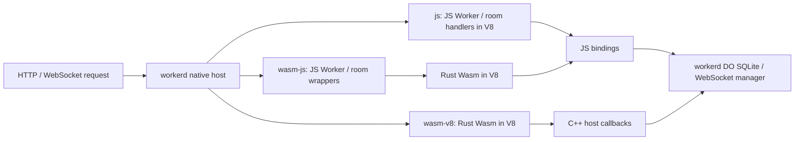

# workerd-campfire-bench

A reproducible comparison of **JavaScript, Rust Wasm with JS bindings, and Rust Wasm with direct C++ host calls** running the same chat workload inside [workerd](https://github.com/cloudflare/workerd). A stateless Worker routes requests to one Durable Object per chat room; each object stores messages in SQLite. Basecamp's original Rust application provides a separate native reference.

**workerd is a native executable in every mode. The Wasm variants compile the application code to Wasm.**

<!-- workerd-benchmark:start -->
## Results

Apple M4 Pro, 48 GiB RAM, macOS-26.5.2-arm64-arm-64bit-Mach-O · 2026-10-21. workerd v1.20261019.1. Medians of 3 5-second trials. Ratios use JS in the same workload.

### Server-rendered HTML (without in-memory page caching): 32 simultaneous clients

Each request authenticates a user, checks room membership, and renders the latest 50 messages. Database and operating-system caches remain active.

| Application runtime | Total requests/s | CPU use (%; 100% = 1 core) | CPU time/request (µs) | Peak process memory (MiB) | p99 response time (ms) |
| --- | ---: | ---: | ---: | ---: | ---: |
| JavaScript / V8 (baseline) | 4,289 (1.00×) | 101.5 (1.00×) | 236.7 (1.00×) | 177.0 (1.00×) | 12.26 (1.00×) |
| Rust Wasm / V8 + JS bindings | 3,921 (0.91×) | 101.7 (1.00×) | 259.6 (1.10×) | 205.2 (1.16×) | 16.96 (1.38×) |
| Rust Wasm / V8 + direct C++ host calls (prototype) | 8,491 (1.98×) | 99.9 (0.98×) | 117.7 (0.50×) | 59.5 (0.34×) | 4.73 (0.39×) |

p99 response time: 99% of requests in a trial finished within this time.

### HTTP chat throughput (total requests/s): 32 simultaneous clients

| Request | JavaScript / V8 (baseline) | Rust Wasm / V8 + JS bindings | Rust Wasm / V8 + direct C++ host calls (prototype) |
| --- | ---: | ---: | ---: |
| Read messages as JSON (no response cache) | 5,702 (1.00×) | 4,490 (0.79×) | 12,387 (2.17×) |
| Server-rendered HTML (with in-memory page caching) | 10,861 (1.00×) | 9,855 (0.91×) | 26,577 (2.45×) |
| Post a message; reply after saving it | 6,291 (1.00×) | 5,926 (0.94×) | 12,479 (1.98×) |
| Mixed reads and posts (100 posts/s target) | 10,204 (1.00×) | 8,902 (0.87×) | 25,931 (2.54×) |

### WebSocket chat throughput (total messages/s)

Each room has one sender plus the receiving connections below. The sender waits for storage, broadcast, and every participant's HTTP read confirmation before sending the next message.

| Rooms and receiving connections | JavaScript / V8 (baseline) | Rust Wasm / V8 + JS bindings | Rust Wasm / V8 + direct C++ host calls (prototype) |
| --- | ---: | ---: | ---: |
| 1 room, 32 receiving connections | 237 (1.00×) | 218 (0.92×) | 415 (1.75×) |
| 5 rooms, 8 receiving connections per room | 817 (1.00×) | 767 (0.94×) | 1,457 (1.78×) |

### Process startup

Medians of 10 fresh processes per mode. Timing includes Wasm compilation; no compiled-module cache is configured. Filesystem caches stay warm.

| Application runtime | Start → first room response (ms) | CPU time to first room response (ms) | Process memory after first room response (MiB) |
| --- | ---: | ---: | ---: |
| JavaScript / V8 (baseline) | 17.40 (1.00×) | 13.16 (1.00×) | 7.8 (1.00×) |
| Rust Wasm / V8 + JS bindings | 20.65 (1.19×) | 17.64 (1.34×) | 10.6 (1.36×) |
| Rust Wasm / V8 + direct C++ host calls (prototype) | 19.30 (1.11×) | 15.98 (1.21×) | 10.0 (1.28×) |

[Complete report](results/2026-10-21-workerd/REPORT.md) · Raw data: [load](results/2026-10-21-workerd/results.json), [startup](results/2026-10-21-workerd/cold-results.json), [validation](results/2026-10-21-workerd/validation.json) · [Measurement provenance](results/README.md).
<!-- workerd-benchmark:end -->

<!-- basecamp-benchmark:start -->
### Original Basecamp Rust application

The unmodified Basecamp application runs with 32 clients in the same session. Ratios use workerd JS for the corresponding request. The original renders 40 rich-text messages per page; the Workers chat renders 50 plain-text messages. SQL, caching, and write durability also differ, so these are whole-application references.

| Original application operation | Total requests/s | CPU use (%; 100% = 1 core) | CPU time/request (µs) | Peak process memory (MiB) | p99 response time (ms) | Response size (KiB) |
| --- | ---: | ---: | ---: | ---: | ---: | ---: |
| Messages HTML; response and fragment caches disabled | 277 (0.06×) | 99.8 (0.98×) | 3,607.3 (15.24×) | 45.6 (0.26×) | 183.33 (14.96×) | 385.0 |
| Messages HTML; original response and fragment caches enabled | 13,391 (1.23×) | 99.6 (0.98×) | 74.4 (0.80×) | 117.8 (0.35×) | 4.07 (0.30×) | 385.0 |
| Post a message; original caches enabled | 3,099 (0.49×) | 137.1 (1.49×) | 442.8 (3.04×) | 133.2 (0.57×) | 19.39 (0.71×) | 9.8 |

[Original application report and raw data](results/2026-10-21-basecamp/REPORT.md) · [Reproduce](basecamp/README.md).
<!-- basecamp-benchmark:end -->

## Request and binding paths

| Mode | Application code | SQL and WebSocket access |
| --- | --- | --- |
| `js` | JavaScript Worker and Durable Object handlers in V8 | Standard JS bindings |
| `wasm-js` — **standard Wasm Worker model in workerd / Cloudflare Workers** | JS entry → Rust Wasm in V8 | Wasm → JS callbacks → standard workerd bindings |
| `wasm-v8` — **patched workerd prototype** | Native entry → the same Rust Wasm in V8 | Wasm → C++ callbacks → workerd's native storage and WebSocket implementations |

`wasm-js` follows the current celld / Cloudflare Workers Wasm model: both the request entry and binding calls use JS. These measurements run locally on workerd.

The direct prototype executes no JS application or binding callback. Its [startup module](workerd/native-worker.js) declares exports; its constructor, HTTP handlers, and WebSocket handlers throw if invoked. V8's callable ABI and Wasm-to-host wrappers remain. Both Wasm modes use the same module, SQL, schema, data, and cache policy. SQLite executes as native code outside Wasm in all three modes.

The [runtime patch](patches/workerd.patch) and [C++ adapter](workerd/native-wasm.c++) retain workerd's actual object routing, activation, request scheduling, input gates, SQLite automatic transactions, output gates, and WebSocket manager. The direct prototype implements this application's synchronous operations; complete Workers APIs, tracing, cancellation, and tenant CPU enforcement are outside its scope.

## Reproduce

[Build, validate, run the benchmarks, or open the chat app](REPRODUCE.md).

## What the numbers measure

All three modes use one patched release executable. JS and Wasm+JS use the standard handlers; direct Wasm is enabled with a process setting. The two Wasm modes share the V8 engine and application module. Their difference includes the JS entry, Request/Response objects, SQL cursor and row conversion, and per-socket wrappers. The results compare complete request paths.

CPU and memory cover the entire workerd server process, including application caches, SQLite, runtime state, and network buffers. Memory is the peak sampled macOS process footprint. The load client runs on the same machine; its CPU is recorded separately. The benchmark uses one node with local persistence.

## Repository files

| Path | Contents |
| --- | --- |
| `application/` | JS chat, JS-to-Wasm adapter, and browser UI |
| `app/` | Rust chat logic, SQL, and database schema |
| `guest/` | Rust Wasm entry points and host imports |
| `workerd/` | Native Wasm adapter, runtime revision, build, run, and report scripts |
| `patches/workerd.patch` | Integration with the pinned workerd source |
| `load/` | HTTP and WebSocket load generators that check responses |
| `bench/` | Shared fixtures, validation, resource sampling, and aggregation |
| `basecamp/` | Build and measurement scripts for Basecamp's unmodified Rust application |
| `results/` | Recorded measurements, measured source files, reports, and provenance |

## References

Derived from [celld-campfire-bench](https://github.com/hyfdev/celld-campfire-bench). [Basecamp Campfire](https://github.com/basecamp/once-campfire/tree/edbc779f4dfc9b26c36310881711ddc976a9dfc8) supplies the chat-application reference. [Campfire in Rust](https://github.com/basecamp/once-campfire-rust/tree/6dae2fd3c1a2dce61ca11beb731bcce2b42b67ad) supplies the original native application. Basecamp's published results use different workloads and hardware.

Runtime base: [workerd v1.20261019.1](https://github.com/cloudflare/workerd/tree/781048bc05cb205c92e503c1062ef3266ab959b5). License: [Apache-2.0](LICENSE); see [NOTICE](NOTICE) for retained upstream notices.
